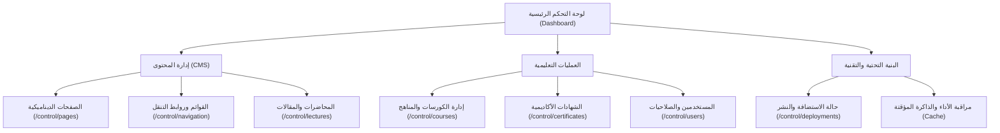

# 📘 دليل إدارة المنصة للمشرفين والمدربين (PHAGLP Admin Guide)

يركز هذا الدليل الشامل على تزويد المشرفين والمدربين بالمهارات والأدوات التقنية اللازمة لإدارة وتطوير أكاديمية **PHAGLP** التعليمية. تمت صياغة هذا مستند باللغة العربية لشرح كيفية تسيير وإدارة المحتوى والتحكم في إعدادات المنصة المتقدمة بكفاءة.

---

## 🏛️ الهيكل الإداري للمنصة (Platform Architecture)

تتألف لوحة التحكم الإدارية من أقسام متكاملة تسمح للمشرف بالتحكم الكامل في رحلة المستخدم والتعليم والبنية التحتية للمنصة:

---

## 📄 أولاً: إدارة الصفحات الديناميكية (CMS Pages Management)

يسمح نظام إدارة المحتوى (CMS) للمشرفين بإنشاء صفحات مخصصة بالكامل (مثل صفحة "من نحن"، "سياسة الخصوصية"، أو صفحات الهبوط التسويقية) دون الحاجة لكتابة أكواد برمجية.

### 1. خطوات إنشاء صفحة جديدة:

1. انتقل إلى القسم الخاص بالصفحات من القائمة الجانبية: [الصفحات](/control/pages).
2. انقر فوق زر **"صفحة جديدة" (New Page)** في الزاوية العلوية اليمنى.
3. قم بتعبئة البيانات الأساسية:
   - **عنوان الصفحة (Page Title):** الاسم الظاهر في أعلى الصفحة.
   - **المحتوى (Content):** محرر يدعم نصوص Markdown وتنسيقات HTML لتصميم محتوى غني.
   - **الرابط (Slug):** العنوان الفريد للصفحة في المتصفح (مثال: `/about` أو `/marriage-guide`).
4. **خيارات الأرشفة وتحسين محركات البحث (SEO Metadata):**
   - **عنوان SEO:** العنوان الذي يظهر في علامة التبويب بالمتصفح.
   - **الوصف الميتا (Meta Description):** ملخص مختصر يظهر في محركات البحث مثل Google لجذب الزوار.
5. **حالة النشر (Visibility):** تفعيل خيار **"نشر" (Published)** لجعل الصفحة عامة فوراً، أو تعطيله لحفظ الصفحة كمسودة (Draft).
6. انقر فوق **"نشر الصفحة" (Publish Page)** لحفظ البيانات.

> [!IMPORTANT]
> **نظام الحماية التلقائي ضد الروابط المعطلة (404 Preventer):**
> إذا قمت بتعديل رابط صفحة (Slug) من `/old-slug` إلى `/new-slug` أو قمت بحذف صفحة بالكامل، يقوم النظام تلقائياً بتحديث كافة القوائم وروابط التنقل المرتبطة بها في قواعد البيانات وتحويلها إلى روابط آمنة لتفادي ظهور صفحة الخطأ 404 للمستخدمين.

---

## 🧭 ثانياً: إدارة قوائم روابط التنقل (Navigation Menus)

تتيح لك أداة إدارة القوائم التحكم في الروابط المعروضة في الشريط العلوي (Header) والتذييل السفلي (Footer) للموقع وتوجيه الزوار بكفاءة.

### 1. إدارة الفئات والقوائم الرئيسية:

- يمكنك الوصول للأداة عبر: [إعدادات القوائم](/control/navigation).
- لإضافة قائمة رئيسية جديدة، انقر فوق **"إضافة قائمة" (Add Menu)**.
- حدد نوع الرابط:
  - **رابط مخصص (Custom URL):** لتوجيه الزوار إلى رابط خارجي أو مسار محدد يدوياً.
  - **صفحة ديناميكية (Dynamic Page):** يتيح لك اختيار صفحة من الصفحات التي قمت بإنشائها مسبقاً في نظام CMS من قائمة منسدلة بشكل مباشر وسهل.
- **الرمز (Lucide Icon):** اكتب اسم الأيقونة المراد إظهارها بجانب القائمة (مثال: `BookOpen`, `Cpu`, `GraduationCap`).
- **خيارات الظهور:** حدد ما إذا كنت تريد إظهار الرابط في شريط التنقل العلوي، أو التذييل السفلي، أو فتحه في علامة تبويب جديدة.

### 2. ترتيب القوائم والروابط الفرعية:

- يمكنك إعادة ترتيب العناصر بسهولة بالنقر على أيقونات الأسهم (لأعلى ولأسفل) بجانب كل عنصر لتعديل ترتيب عرضه الفعلي فوراً.
- يمكنك النقر على أي قائمة رئيسية لإضافة روابط فرعية (Sub-items) تظهر كقائمة منسدلة منبثقة عند مرور مؤشر الفأرة.

---

## 🎓 ثالثاً: إدارة المناهج والكورسات (Course & Curriculum Management)

بصفتك مديراً للمنصة أو مدرباً، يمكنك إدارة العملية التعليمية بالكامل وتحديث المناهج الدراسية:

### 1. إضافة وتعديل الكورسات:

1. انتقل إلى لوحة [إدارة الكورسات](/control/courses).
2. قم بإضافة كورس جديد مع تحديد: العنوان، الوصف التفصيلي، السعر، وصورة الغلاف وتعيين المدرب المسؤول.
3. حدد مستوى الكورس (مبتدئ، متوسط، متقدم).

### 2. إدارة الوحدات والدروس (Curriculum Manager):

- يدعم النظام ميزة **السحب والإفلات (Drag and Drop)** لإعادة ترتيب المحاضرات والوحدات الدراسية.
- يمكنك إضافة اختبارات قصيرة (Quizzes) أو إرفاق ملفات PDF كمرفقات تعليمية مساندة لكل درس لتطوير التجربة التعليمية.

---

## 📜 رابعاً: إدارة الشهادات الأكاديمية للباحثين (Scholar Certificates Manager)

تم تجهيز المنصة بنظام متطور لإصدار وتوثيق شهادات التخرج للباحثين والطلاب الذين أتموا متطلبات الكورسات بنجاح.

- يمكنك الوصول إلى لوحة الإدارة من هنا: [إدارة الشهادات الأكاديمية](/control/certificates).

### 1. طرق إصدار الشهادات:

- **الإصدار التلقائي (Automatic Awarding):** عندما تكتمل نسبة إنجاز الطالب في كورس معين وتصل إلى 100% (بإتمام كافة الدروس والوحدات)، يقوم النظام تلقائياً بتولد شهادة تخرج معتمدة وحفظها في حساب الطالب.
- **الإصدار اليدوي (Manual Awarding):** يمكن للمشرفين والمدربين إصدار شهادات يدوياً للطلاب المتميزين من لوحة التحكم عن طريق:
  1. اختيار الطالب من قائمة المستخدمين.
  2. تحديد الكورس المراد التكريم فيه.
  3. تعيين التقدير أو المرتبة العلمية (مثال: ممتاز مع مرتبة الشرف الأولى، Pass with Distinction A).
  4. النقر فوق زر **"إصدار الشهادة" (Issue Certificate)**.

### 2. نظام التوثيق الفريد والتحقق (Verification Code):

- يتم تزويد كل شهادة برمز توثيق مشفر فريد وغير قابل للتكرار (مثال: `CERT-2026-X7Y2-A9Z1`).
- يتيح هذا الرمز للجهات الخارجية (مثل أصحاب العمل أو الجامعات) التحقق من صحة وصلاحية الشهادة مباشرة عبر صفحة التحقق العامة بالمنصة دون الحاجة لتسجيل الدخول.

### 3. سحب وإلغاء الشهادات (Revoking Certificates):

- يمتلك المشرفون (ADMIN) فقط صلاحية سحب أو إلغاء أي شهادة تم إصدارها بالخطأ أو في حالات الإخلال بالأمانة العلمية، وذلك بنقرة واحدة من لوحة التحكم ليتم حظر رمز التحقق فوراً وحذف الشهادة من ملف الطالب.

---

## 🚀 خامساً: إدارة النشر والاستضافة التقنية (Vercel Deployments)

تم دمج نظام النشر والتحكم في الاستضافة مباشرة داخل لوحة التحكم الإدارية لتسهيل مراقبة تحديثات الموقع واستقرار البنية التحتية.

- يمكنك استعراض حالة النشر من هنا: [لوحة النشر والتطوير](/control/deployments).

### 1. الميزات المتاحة للمشرف:

- **مراقبة التحديثات الحية:** استعراض حالة البناء البرمجي الحالية (Building، Ready، Error).
- **إعادة النشر (Redeploy):** في حال حدوث أي مشكلة أو الرغبة في تحديث خوادم المنصة يدوياً بأحدث نسخة من الكود، يمكنك النقر فوق زر **"إعادة النشر" (Redeploy)**.
- **فحص سجل الأخطاء (Log Streamer):** في حال فشل أي عملية بناء للموقع، تقوم اللوحة تلقائياً بجلب وتحليل سجل الخادم (Server Events) وتلخيص الخطأ البرمجي الدقيق لمساعدتك في حله فوراً دون الخروج من المنصة.

---

## 👥 سادساً: إدارة المستخدمين والأدوار الإدارية (User & RBAC Management)

يعتمد نظام الأمان بالمنصة على نموذج **التحكم بالوصول القائم على الأدوار (RBAC)** لحماية البيانات الحساسة وتوزيع الصلاحيات.

| الدور الإداري (Role)    | الصلاحيات المتاحة (Permissions)                                                                                  |
| :---------------------- | :--------------------------------------------------------------------------------------------------------------- |
| **المشرف (ADMIN)**      | صلاحيات كاملة على المنصة تشمل إدارة الخوادم، تعديل أدوار المستخدمين، تعديل المحتوى، وإدارة الفواتير والاشتراكات. |
| **المدرب (INSTRUCTOR)** | صلاحيات مقتصرة على إنشاء المناهج، تعديل تفاصيل الكورسات التابعة له، تصحيح الاختبارات، والتفاعل مع الطلاب.        |
| **الطالب (USER)**       | تصفح الكورسات المتاحة، التسجيل في المسارات التعليمية، استعراض المحاضرات والملفات، واستلام الشهادات عند الإنجاز.  |

### تعديل أدوار المستخدمين:

1. انتقل إلى لوحة [إدارة الأعضاء](/control/users).
2. استخدم شريط البحث للتصفية بناءً على البريد الإلكتروني أو الاسم.
3. انقر على **"تعديل الصلاحية" (Manage Role)** لتحديث رتبة العضو وتطبيق القيود الأمنية تلقائياً في لحظتها.

---

## ⚡ سابعاً: نظام الذاكرة المؤقتة التلقائي (Site Caching Systems)

لضمان سرعة تحميل فائقة وتجربة مستخدم متميزة، تستخدم الأكاديمية نظام كاش هجين يعتمد على **Redis Cache** و **Next.js Tags**:

- عند قيامك بتحديث أي قائمة تنقل أو صفحة ديناميكية، يتم تلقائياً تفريغ الذاكرة المؤقتة الخاصة بالقوائم والصفحة المعنية فوراً (Instant Cache Invalidation).
- يضمن هذا ظهور التحديثات التي قمت بها لجميع زوار الموقع فوراً في شريط التنقل دون أي تأخير، مع الإبقاء على سرعة استجابة الموقع أقل من 50 جزء من الثانية.
